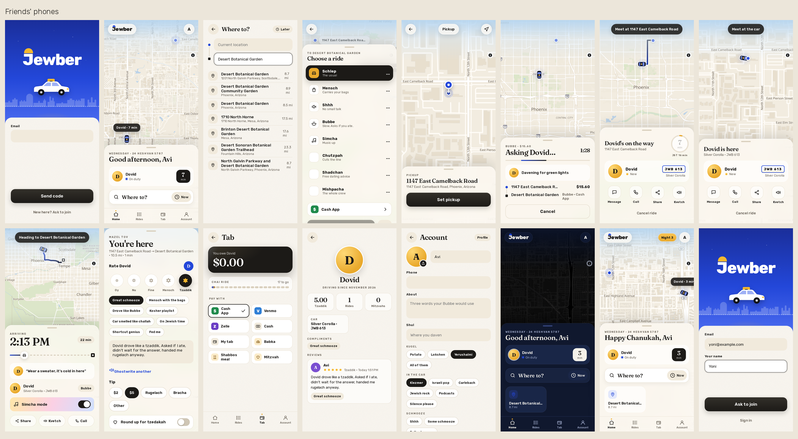
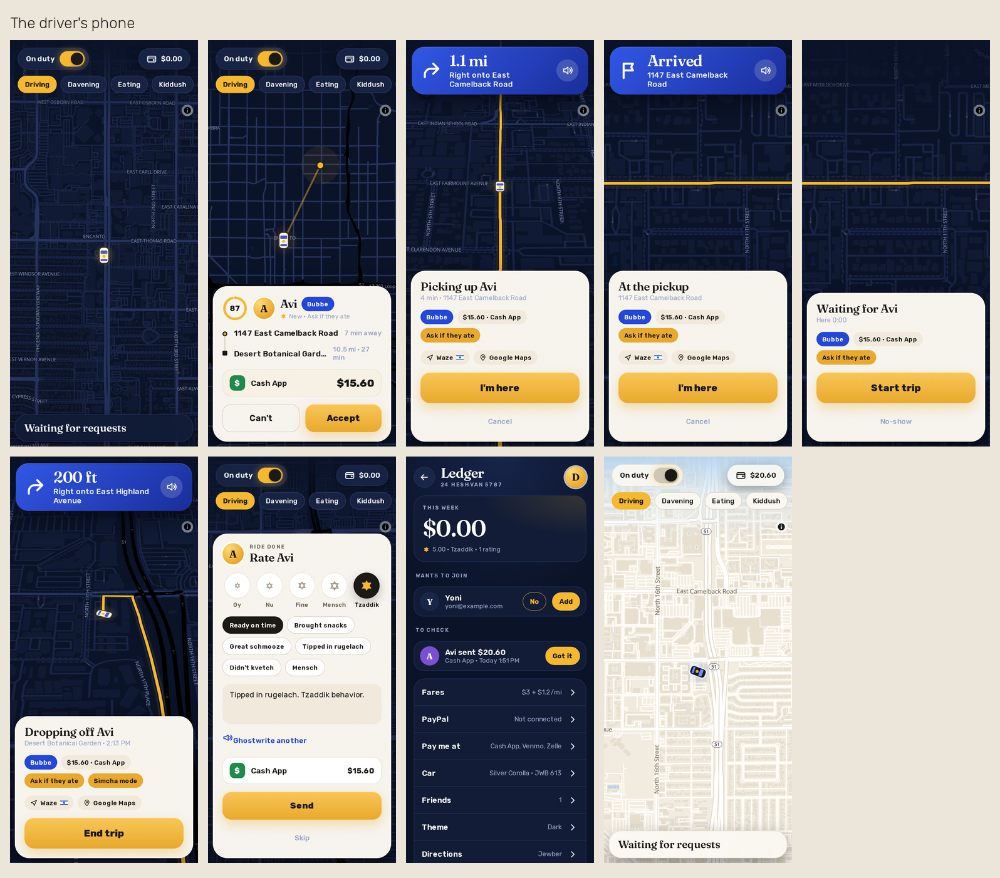
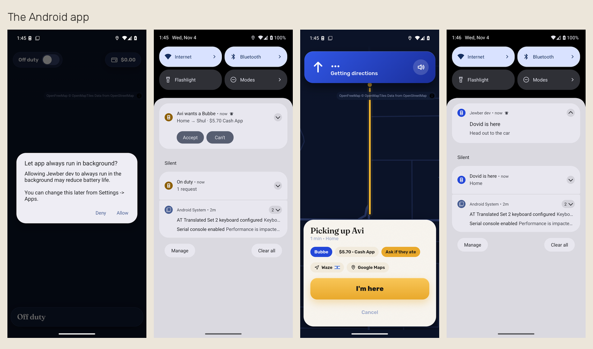

# Jewber

Jewber is Uber, but just for me and a handful of friends. I'm the only driver, my friends are the only riders, and it works the way you'd expect: they ask for a ride on a map, my phone rings, I accept, they watch my car come to them live, we ride, they pay and rate me. The difference is that it's Jewish all the way through. It closes itself for Shabbat and Yom Tov, a ride can be paid in babka, the ride types are things like "Schlep" and "Bubbe", and the ratings go from Oy to Tzaddik.

It's meant to be FUN and funny, but it's also a real app that I actually use, so everything that looks like a joke also does something.







## Getting it

**Android:** download the APK from the newest release on the [Releases page](../../releases/latest) and open it. Android asks once to allow installs from your browser, which is normal for apps that don't come from the Play Store. If you'd rather get updates on their own, add this repo's address to Obtainium and it will pick up every new release.

**iPhone:** open the site in Safari, then Share → Add to Home Screen. It installs like an app, with its own icon and notifications.

**Anywhere else:** it's a website, so any browser works.

## What it does

For friends:
- **Signing in** is a 6-digit code by email, no password. Only people the driver has added can get one. Someone new can "Ask to join" from the sign-in screen, and the driver gets a ping and says Add or No. Adding someone sends them an invitation email.
- **Where to?** searches real addresses (OpenStreetMap). You can also drop a pin: "Set on map", or tap the pickup or destination on the ride map, and drag the map under the pin.
- **Ride types:** Schlep (the usual), Mensch (carries your bags), Shhh (no small talk), Bubbe (slow, asks if you ate), Simcha (music up), Chutzpah (cuts the line, and it really does jump the driver's queue), Shadchan (free dating advice) and Mishpacha (the whole crew). Each has its own price.
- **The ride:** while it asks the driver, it tells you jokes like "It's always Dovid". On the way you get a live car, an ETA ring, and the ETA in Jewish Standard Time. Then the arrival time, and lines like "Did you eat?" if you picked Bubbe. You also get Simcha mode, Share, Call, and a Kvetch button with one-tap kvetches. A shofar sounds when the driver accepts, and a burst of gold Stars of David goes off when you arrive.
- **Paying:**
  - **PayPal** is real checkout, with a PayPal account or just a card, and the ride marks itself paid.
  - **Cash App and Venmo** open with the amount filled in. **Zelle** shows the handle and the amount to copy.
  - **Other ways:** cash, or put it on your tab. Or pay in babka, a Shabbos meal, or a mitzvah.
  - **Tips** can be dollars, rugelach, or a bracha ("May all your lights be green"). You can round up for tzedakah.
  - **Chai rides:** every 18th ride is on the house.
- **Reviews:** Oy, Nu, Fine, Mensch or Tzaddik, plus compliment badges ("Car smelled like challah") and your own words. If you don't feel like writing, "Ghostwrite it" writes something funny for you.
- **Profiles:** a photo, about you, your shul, your kugel, your music, how much you like to schmooze, languages, a fun fact, and your reviews.
- **The rest:** light, dark or automatic. The Hebrew date and the parsha are on the home screen, and holidays change the greeting and the look (Chanukah shows tonight's candle).

For the driver:
- **Requests:** On duty / Off duty, with a status your friends see (Davening, Kiddush, Costco run, Shiva call…). Requests ring like a phone call, with Accept and Can't right on the notification.
- **Directions:** turn-by-turn with a VOICE, a map that turns with you, and rerouting when you miss a turn. "You've arrived" pops up at the pickup and the drop-off. If you'd rather drive with Waze or Google Maps, there's a setting that opens it on its own.
- **The ledger:**
  - The week's money (and babkas), who owes what with a Nudge button, and payments to check.
  - PayPal payments with the fee and a Refund button.
  - The tzedakah jar, brachot received, kvetches, and people asking to join.
- **Shabbat:** Jewber closes 30 minutes before candle lighting and opens at havdalah (Hebcal times for Phoenix or Jerusalem). Friends see candles and a countdown, and can book for Motzei Shabbat.

## Running your own

Basically it's one Node program with no dependencies (Node 22 or newer), a folder for its state, and the page in `web/`.

```bash
node server.js driver you@example.com Yourname     # who drives (do this with the server stopped)
node server.js                                     # http://127.0.0.1:8525
```

- **Settings** are environment variables: `JEWBER_STATE` (the state folder), `JEWBER_PORT`, `JEWBER_HOSTS`, `JEWBER_URL` (the public address), `JEWBER_PAYPAL_ENV` (an env file with PayPal keys), `JEWBER_NOTIFY` (a script that pings the driver).
- **Email:** sign-in codes go out through any SMTP server you put in `mail.json` in the state folder (see `lib/mail.js`).
- **Running it all the time:** `deploy/` has a systemd unit and a small deploy script. They run it from its own worktree, so working on the code never touches the running app.
- **Free services it uses:** maps from OpenFreeMap, routes from OSRM's demo server, addresses from Photon, and times from Hebcal. Each gets light use and a clear User-Agent.

**Android:** `android/` is a small Java app (no AndroidX, no Google Play services). It wraps the site and adds what a web page can't do:
- **GPS** with the screen off.
- **Ringing requests** you can answer from the notification.
- **The voice** and the arrival alerts.

Build it with `JEWBER_STATE=/path/to/state android/release.sh`. It signs with your own key from the state folder and puts the APK where the site serves it.

## Tests

```bash
node tools/e2e.js              # a whole ride and everything around it, through the API (27 steps)
node tools/paypal-check.js     # PayPal against a pretend PayPal (10 checks)
node tools/walk.js OUT         # the real page in headless Chrome, two phones and a simulated drive, with screenshots
node tools/android-check.js APK OUT   # the Android app on an emulator (16 checks)
```

All of them run their own throwaway server with email going to a file, never a real one.

## License

MIT. The icon's font is Rubik (SIL Open Font License); `design/icon.py` says where to get it.
