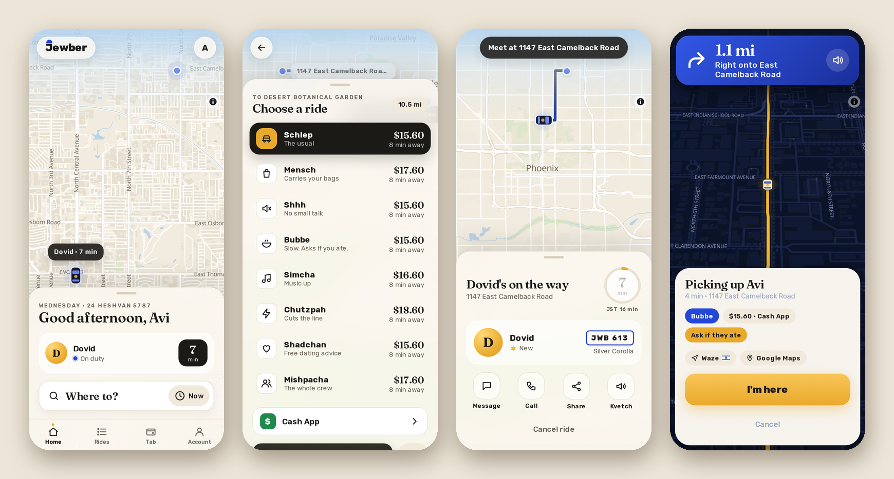
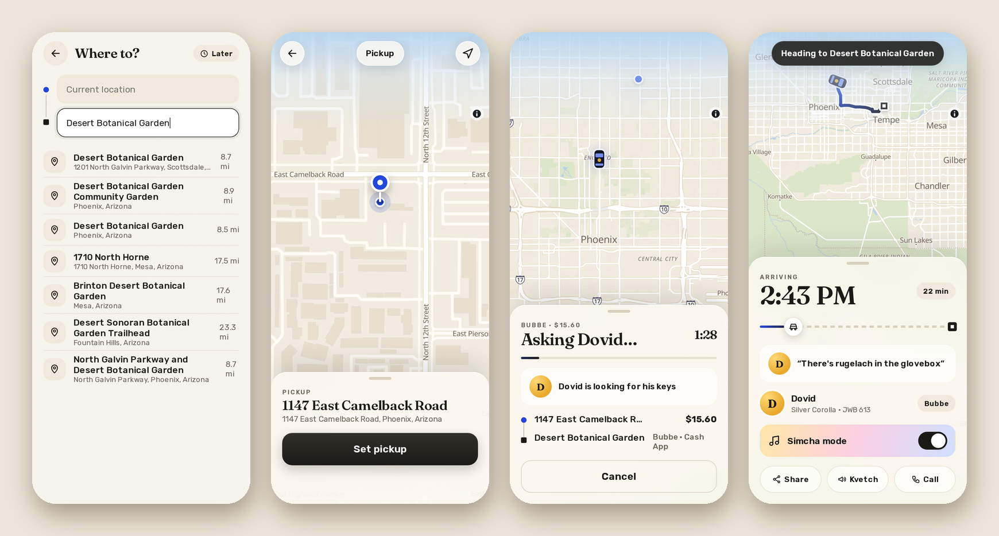
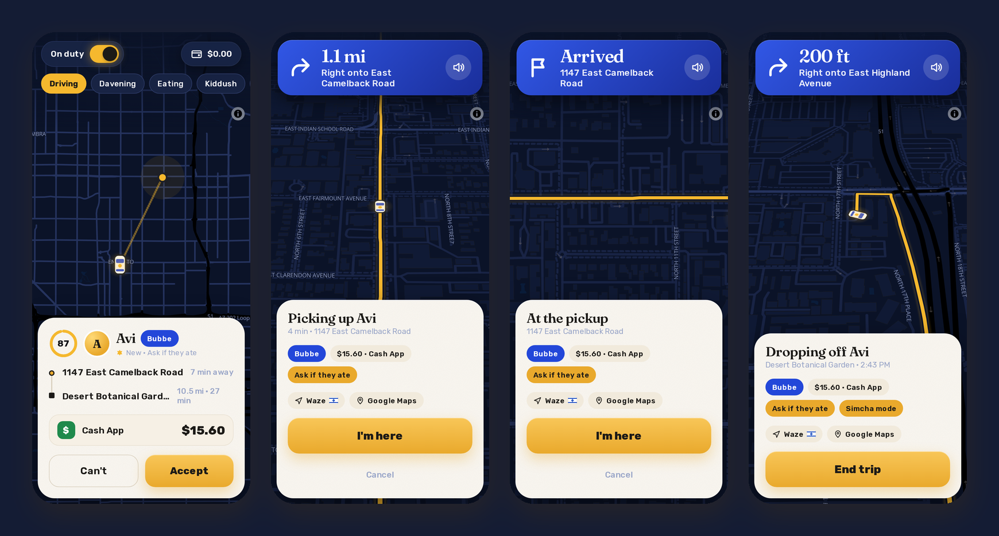
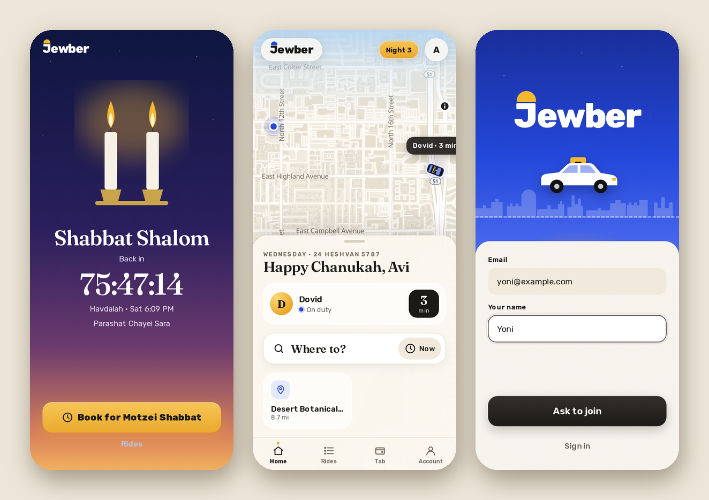

  

<h1 align="center">Jewber</h1>

<b>Uber, but just for me and a handful of friends.</b> A real ride app with a live map, turn-by-turn and PayPal, that also closes for Shabbat and takes payment in babka.

  
  
  
  

  <a href="docs/README.md"><b>Docs</b></a> ·
  <a href="#why-i-made-it">Why I made it</a> ·
  <a href="#what-it-does">What it does</a> ·
  <a href="#screenshots">Screenshots</a> ·
  <a href="#getting-it">Getting it</a> ·
  <a href="#how-its-built">How it's built</a> ·
  <a href="#license">License</a>

## Why I made it

I drive my friends around a LOT, and it always worked the same way: a text, then "where are you?", then "I'm outside", then nobody remembering who owes who for gas. So I made Jewber, which is basically Uber with exactly one driver (me) and a handful of riders (my friends).

It does everything you'd expect from a ride app. My friends ask for a ride on a map, my phone rings, they watch my car come to them live, and they pay at the end. But it's meant to be fun and FUNNY too, so it's Jewish all the way through. It closes itself for Shabbat, a ride can be paid in babka, the ride types are things like Schlep and Bubbe, and the ratings go from Oy to Tzaddik. Everything that looks like a joke also does something.

## What it does

- **Asking for a ride:** search a real address or drop a pin, then pick the kind of ride. Schlep is the usual, Mensch carries your bags, Bubbe drives slow and asks if you ate, and Chutzpah cuts the line (it really does jump the queue). You can also book for later, Motzei Shabbat included.
- **The ride itself:** a live car on the map, an ETA ring (plus the ETA in Jewish Standard Time), "is here" with the plate, and the arrival time while you ride. There's also Simcha mode, Share, Call, and a Kvetch button.
- **Paying:**
  - **PayPal** is real checkout (PayPal account or just a card), and the ride marks itself paid. Cash App and Venmo open with the amount filled in, and Zelle shows the handle.
  - **The friendlier ways:** cash, the tab, babka, a Shabbos meal or a mitzvah.
  - **Tips** in dollars, rugelach or a bracha. You can round up for tzedakah, and every 18th ride (chai) is on the house.
- **Reviews and profiles:** Oy to Tzaddik, compliment badges ("Car smelled like challah") and your own words, or "Ghostwrite it" for a funny one. Profiles have a photo, your shul, your kugel, your music and how much you like to schmooze.
- **For the driver:**
  - **Requests:** they ring like a phone call, with Accept and Can't right on the notification.
  - **Directions:** turn-by-turn with a voice, a map that turns with you, rerouting, and "You've arrived". Or have it open Waze or Google Maps by itself.
  - **The ledger:** the money, the babkas, who owes what, PayPal payments with refunds, and a tzedakah jar.
- **Shabbat and the calendar:** it closes 30 minutes before candle lighting and opens at havdalah. The Hebrew date and the parsha are on the home screen, and the holidays change the greeting and the look.
- **Signing in:** a 6-digit code by email, or a username and password if you set one. Friends either sign up from a shared link (/join, email proven by a code) and wait for the driver's approval, or the driver adds them by hand, and the emails (the invitation, the code, a nudge about the tab) come dressed up in Jewber's colors.
- **The map:** a locate button that follows you and can turn the map with your phone's compass, two-finger rotate, and a compass that puts north back on top.

## Screenshots

More in the [docs](docs/README.md).

## Getting it

The site has a Get the app page (`/get`) with these steps for both phones, the visitor's own phone first. The Android app is one app for friends and the driver.

- **Android:** download the APK from the newest release on the [Releases page](../../releases/latest) and open it. Android asks once to allow installs from your browser, which is normal for apps that don't come from the Play Store. To get updates on their own, add this repo's address to Obtainium.
- **iPhone:** open the site in Safari, tap ⋯ then Share (older iPhones have Share in the toolbar), then Add to Home Screen. It installs like an app, with its own icon and notifications.
- **Anywhere else:** it's a website, so any browser works.

My own Jewber is just for me and my friends, so it needs an invitation to sign in. If you want your own, everything you need is in this repo, and [Running your own](docs/DEVELOPING.md) explains how.

## How it's built

- **The server:** `server.js` is the whole thing, one Node program with no dependencies. The state is a single JSON file, and every signed-in page and phone gets its view live over server-sent events.
- **The page:** `web/` is plain JavaScript with MapLibre. Maps come from OpenFreeMap, routes from OSRM, addresses from Photon and Shabbat times from Hebcal, all free, and Jewber asks each of them for very little.
- **The Android app:** `android/` is a small Java app around the site. It adds what a web page can't do: GPS with the screen off, ringing requests, the voice, and arrival alerts.
- **The tests:** `tools/` walks whole rides through the API, through the real page in headless Chrome (with a simulated drive), and through the Android app on an emulator.

## License

MIT. The icon's font is Rubik (SIL Open Font License), and `design/icon.py` says where to get it.
