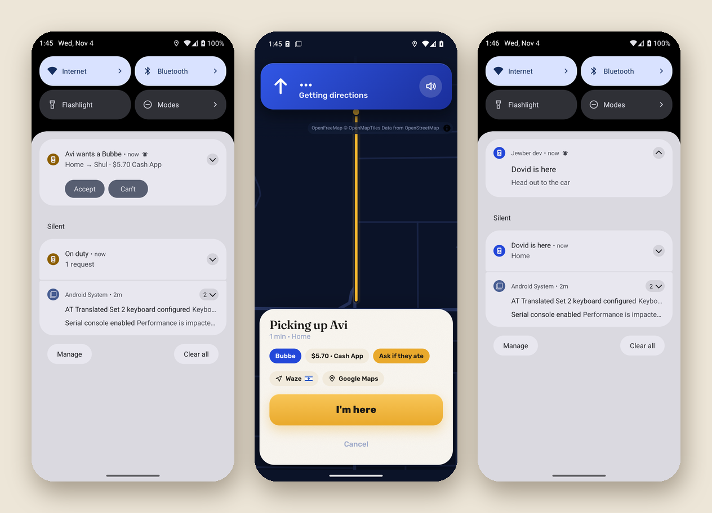

# The Android app

The Android app is the same Jewber, in a window of its own, plus the things a web page can't do on a phone. It's one app for everyone: friends get the rider side, and the driver's account gets the driver side.

## Installing and updating

Download the APK from the newest release on the GitHub Releases page and open it (Android 11 or newer). Android asks once to allow installs from your browser, which is normal for apps that don't come from the Play Store. The first time you open it, it asks for location and notifications. Say yes to both, since that's what the app is for.

For updates, add the GitHub repo to Obtainium and it picks up every new release by itself. A new version always installs right over the old one, and you stay signed in.

## What it adds for the driver

- **GPS with the screen off:** on duty, my location goes to Jewber every few seconds, even with the screen off or Waze in front. There's an "On duty" notification while it does, with Go off duty on it. It also asks once to be left alone by the battery saver, so the phone doesn't stop it.
- **Requests that ring:** like a phone call, with Accept and Can't right on the notification. Accept opens the app on the directions.
- **The voice:** directions spoken with the phone's own voice, ducking the music.
- **Arriving:** near the pickup or the drop-off, a notification with I'm here (or End trip) on it, for when another app is in front.

## What it adds for friends

While you have a ride, the app keeps it in a notification ("Asking Dovid", then "Dovid's on the way · 4 min", "Dovid is here", "Arriving 2:43 PM"), with a ping when it changes, and "You're here" at the end. You can put the phone away the whole time.

## PayPal and the app

PayPal opens in your browser. When you're done there, "Back to Jewber" brings you straight back into the app, which says it's paid.

Next: [Running your own](DEVELOPING.md).
