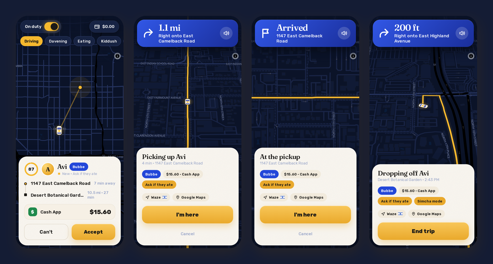

# Driving

This part is for me, the driver. My account gets the driver's side of the same app, in night colors unless I pick light.

## On duty

The switch at the top left is On duty / Off duty. On duty means my friends see my car (roughly, until I'm coming for one of them) and can ask for a ride now. Off duty, they can only book for later. The chips under it are my status, which my friends see too: Driving, Davening, Eating, Kiddush, Costco run, At a simcha, Shiva call, Errands, Back soon. The money pill at the top right is this week's money, and it opens the ledger.

In the Android app, being on duty also means a notification with "On duty" on it, my GPS going to Jewber every few seconds even with the screen off, and Go off duty right on the notification. When Shabbat starts, Jewber takes me off duty by itself.

## Requests

A request shows who, which kind of ride (with a hint, like "Ask if they ate" for Bubbe), where from and where to, how far, and how they'll pay. A ring counts down the time I have to answer. In the Android app it rings like a phone call, with Accept and Can't right on the notification, and I get a Signal message too if I've set that up. Chutzpah requests go to the top of the list.

## Directions

After I accept, the screen turns into directions. The banner shows the next turn and how far it is, and a VOICE says it ("In a quarter mile, turn left onto North 7th Street"), over my music, which ducks for it. The speaker button on the banner mutes it. The map turns with me and tilts, and if I drag it, Recenter brings it back. If I miss a turn, it says "Rerouting" and finds a new way.

If I'd rather drive with Waze or Google Maps, the buttons are on the card, and the Directions setting can open one by itself whenever I accept a ride and when I start the trip.

## Arriving, the trip, the end

Within about 50 m of the pickup, the card says "At the pickup" with a glowing I'm here, and a button to text "I'm outside". With Waze in front, a notification says "You're at Avi's pickup" with I'm here on it. Then Start trip, and the directions go to the drop-off. At the drop-off it's End trip, the same way.

After the trip I rate my friend (Oy to Tzaddik), add compliments ("Ready on time", "Tipped in rugelach") or a review, or let "Ghostwrite it" write one. Skip is fine too.

Next: [The ledger](the-ledger.md).
