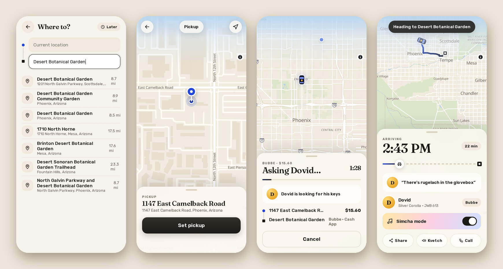

# Getting a ride

## Where to?

Tap "Where to?" and start typing. Jewber searches real addresses and places (from OpenStreetMap), closest first. The pickup is where you are now, unless you tap it and pick something else.

If the address isn't quite right, or there isn't one, use a pin. "Set on map" is in the list under both fields, and on the next screen you can also tap the pickup or the destination right on the map. The pin stays in the middle and you drag the map under it, and the address follows as you go. When it's right, tap Set pickup (or Set destination).

Your places (Home, Shul, work…) and the last few places you went are one tap away, on the home screen and in "Where to?". You can add and remove places in Account.

## The map

The arrow button at the bottom right of the map shows where you are, with a blue dot, and keeps following you as you move. Tap it again and the map turns with your phone, the way you're facing (an iPhone asks first). A third tap goes back to north-up. Dragging the map lets go.

You can turn the map with two fingers. When it's turned, a compass shows up above the arrow, with its red needle pointing north, and a tap puts north back on top.

## The kinds of rides

Each one has its own price, and I see which one you picked:

- **Schlep:** the usual.
- **Mensch:** I carry your bags.
- **Shhh:** no small talk.
- **Bubbe:** slow, and I ask if you ate.
- **Simcha:** music up.
- **Chutzpah:** cuts the line. If I have more than one request, yours goes to the top.
- **Shadchan:** comes with free dating advice.
- **Mishpacha:** the whole crew.

Below the list is how you'll pay, which you can change. Then Request, or the clock next to it to book for later.

## Booking for later

Tap the clock (or "Later" on the home screen). You can pick a time yourself, or tap In 1 hour, Tomorrow 9 AM, or Motzei Shabbat when Shabbat is coming up. I get the request and say Book it or Can't, and it shows under "Coming up" in Rides until I come to get you. When I'm off duty, booking for later is the only way to ask. Jewber won't book anything during Shabbat or Yom Tov.

## While Jewber asks me

You see "Asking Dovid…" (or whatever your driver is called) with a countdown, and a few jokes while you wait. If I don't answer in about a minute and a half, or I tap Can't, Jewber tells you, and you can try again or book for later.

## On the way, here, and the ride

Once I accept, you see my car on the map coming to you, the minutes in a ring that fills as I get closer, and the same minutes in Jewish Standard Time. You can message me, call me, share where I am with someone, or kvetch (one tap for "Too hot", "The music" and the rest). When I'm outside, it says so, with the car and the plate.

During the ride you see the arrival time and a little car moving along the trip. Simcha mode turns the music up. If you picked Bubbe or Shadchan, you'll get the occasional line from me too.

Next: [Paying, tips and reviews](paying.md).
