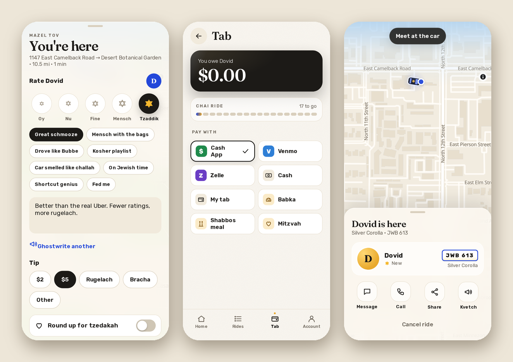

# Paying, tips and reviews

When the ride is over you get "You're here" (and a few gold Stars of David). This is where you rate me, tip, and pay, all on one screen.

## The ways to pay

- **PayPal:** real checkout. You pay on PayPal's own page, with your PayPal account or just a card, and the ride marks itself paid as soon as you're done, so I don't have to check anything. If I've set it that way, PayPal's fee is added to your total, and you'll see it as its own line.
- **Cash App and Venmo:** they open with my handle and the amount already filled in.
- **Zelle:** shows my email or phone # and the amount, each with a Copy button.
- **Cash:** you hand it to me, and I mark it in the ledger.
- **My tab:** it waits. The Tab screen shows what you owe, and "Pay now" pays it all at once (PayPal works for the whole tab in one go).
- **Babka, a Shabbos meal:** you owe me one, and I mark it when it arrives.
- **Mitzvah:** free.

## Tips

$2, $5, any amount, rugelach, or a bracha. A bracha is picked from a list ("May all your lights be green", "May your kugel never burn"…), and I keep the ones I get. If you're paying in dollars, "Round up for tzedakah" rounds your total up to the next dollar, and the extra goes in my tzedakah jar.

## Chai rides

Every 18th ride is on the house. The Tab shows how many to go, and when it's your 18th, the ride says "Free" before you even ask.

## Rating and reviewing me

Oy, Nu, Fine, Mensch or Tzaddik. You can add compliments ("Great schmooze", "Car smelled like challah", "On Jewish time") and a few words. If you don't feel like writing, "Ghostwrite it" writes something funny for you, and you can tap it again for another one. Your review goes on my profile, with your name on it, and I get a message.

Next: [Your profile](your-profile.md).
