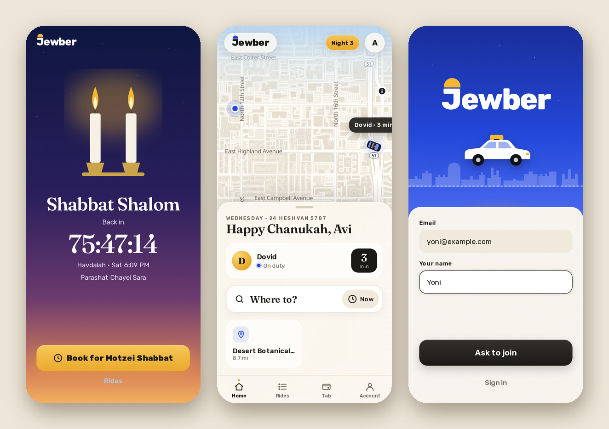

# Shabbat and the calendar

## Closed for Shabbat and Yom Tov

Jewber closes itself 30 minutes before candle lighting, so I have time to get home, and opens again at havdalah. That goes for Yom Tov too, and when Shabbat runs right into Yom Tov it's one long closing. The times come from Hebcal, for wherever I am (Phoenix or Jerusalem, or pick one in Settings).

While it's closed, my friends see two candles, "Shabbat Shalom", a countdown to havdalah, and this week's parsha. "Book for Motzei Shabbat" books a ride for right after. I'm taken off duty, and nothing can be booked inside the closing.

On Friday afternoon a gold chip counts down to Shabbat ("Shabbat in 2:14"), on my friends' screens and on mine.

## The calendar

- **The Hebrew date** is under the greeting on the home screen, like "Wednesday · 24 Heshvan 5787".
- **The parsha** is there too from Thursday to Shabbat, and on the Shabbat screen.
- **On Friday afternoon** the greeting is Shabbat Shalom, and on Motzei Shabbat it's Shavua tov.

## The holidays

On a holiday the greeting changes, a chip shows up next to the logo, and the arrival confetti changes color:

- **Chanukah:** "Happy Chanukah", the night ("Night 3"), and a little menorah on my car on the map.
- **Purim:** "Freilichen Purim", "Costumes welcome", and a party hat on my car.
- **Pesach:** "Chag kasher v'sameach" and "Kosher for Pesach car".
- **Rosh Hashana:** "Shana tova" and "Apples & honey".
- **Yom Kippur:** "G'mar chatima tova" (and it's closed anyway).
- **Sukkot:** "Chag sameach" and "Lulav rides free".
- **Yom HaAtzma'ut:** blue and white confetti.
- **The smaller days:** Tu BiShvat, Lag BaOmer, Rosh Chodesh and Tisha B'Av each get their own line.

To see a holiday's look on any day, add `?fun=chanukah` (or purim, pesach, atzmaut and the rest) to the address. `?fun=shabbat` shows the Shabbat screen.

Next: [All the fun](the-fun.md).
