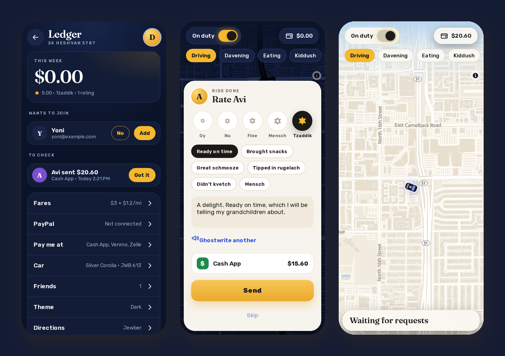

# The ledger

The ledger is the money and the people. I open it from the money pill on my map.

## The money

- **This week:** the money that's actually in, plus the babkas, Shabbos meals and mitzvahs, and my rating.
- **To check:** payments my friends say they sent by Cash App, Venmo, Zelle or cash. Got it marks them paid. PayPal never shows up here, because it marks itself.
- **Owed:** who owes what, and from how many rides. Nudge sends them an email and a notification (once every few hours at most). Paid clears it, for when they paid some other way.
- **PayPal:** each PayPal payment, with PayPal's fee and what's left after it. Refund sends it back through PayPal, and the ride goes back to owed.
- **Tzedakah jar:** the rounded-up cents from everyone who picked "Round up for tzedakah". Gave it empties the jar when I've given it.
- **Brachot:** the blessings I've been tipped.
- **Kvetches:** what my friends complained about, and when.

## The people

- **Wants to join:** people who signed up with the link and proved their email, with how we know each other and their phone #. Approve makes their account and sends the "You're in" email, and No says no, quietly. They also show up on my home screen while I'm not on a ride.
- **Sign-up link:** the /join link, ready to share (or copied, where sharing isn't there).
- **Friends:** everyone who can sign in. Add a name and an email to invite someone, or Remove to take them off (which also signs them out).

## Settings

- **Fares:** the base, the price per mile, and the minimum. Mensch, Simcha, Chutzpah and Mishpacha add a little on top.
- **PayPal:** connected or not, and who pays PayPal's fee (3.49% + $0.49): me, or my friends.
- **Pay me at:** my Cash App, Venmo and Zelle.
- **Car:** my name, the car, the plate and my phone #.
- **Theme:** Auto, Light or Dark.
- **Directions:** Jewber's own, or open Waze or Google Maps by itself.
- **Shabbat times:** where I am, Phoenix, or Jerusalem.
- **Signal pings:** a message for every request, if the server has a script for it.

My own account (photo, About, Kugel and the rest) is behind my face at the top right.

Next: [Shabbat and the calendar](shabbat-and-the-calendar.md).
