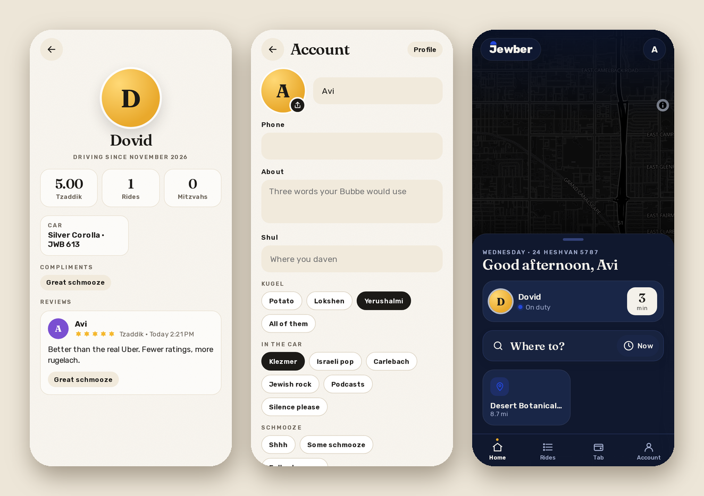

# Your profile

Account is where you are. Everything saves as you change it.

- **Your photo:** tap the circle and pick one. Jewber crops it to a square and makes it small before it leaves your phone. Remove photo takes it off again.
- **Your name and phone #:** your phone # is only shown to me, and only during a ride, so I can text you "I'm outside".
- **About, Shul, Languages, Fun fact:** whatever you want people to know.
- **Kugel, In the car, Schmooze:** tap one. This is the important stuff, like Yerushalmi, Klezmer, Full schmooze.

The Profile button shows your page the way it looks to others: your photo, your rating as a rider, your rides, the compliments I've given you, and my reviews. You can see my page by tapping my face anywhere in the app.

## Signing in

Under Signing in you can pick a username and set a password, so you can sign in with either your email or your username and the password instead of waiting for a code. Changing the password asks for the old one and signs you out everywhere else. Remove password takes it away again, and the email code always works.

## Light and dark

Auto, Light or Dark, in Account. Auto follows your phone. It's saved per phone, so it can be dark on your phone and light on your laptop.

## Sounds and notifications

Sounds turns the shofar (when I accept) and the chime (when I'm outside) on or off. On a website or the iPhone home-screen app, Notifications asks your browser for permission so you get "on the way" and "is here" with the app closed. The Android app does this by itself.

Next: [Driving](driving.md).
